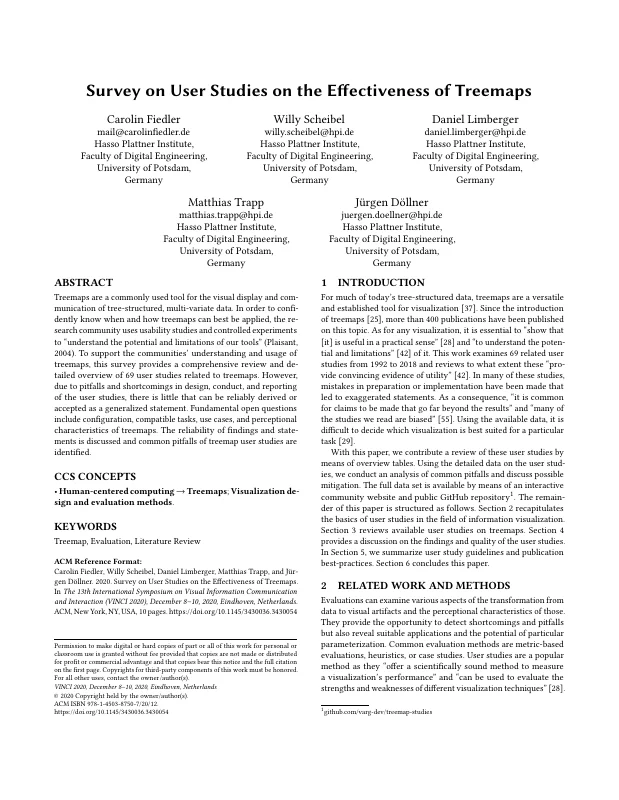
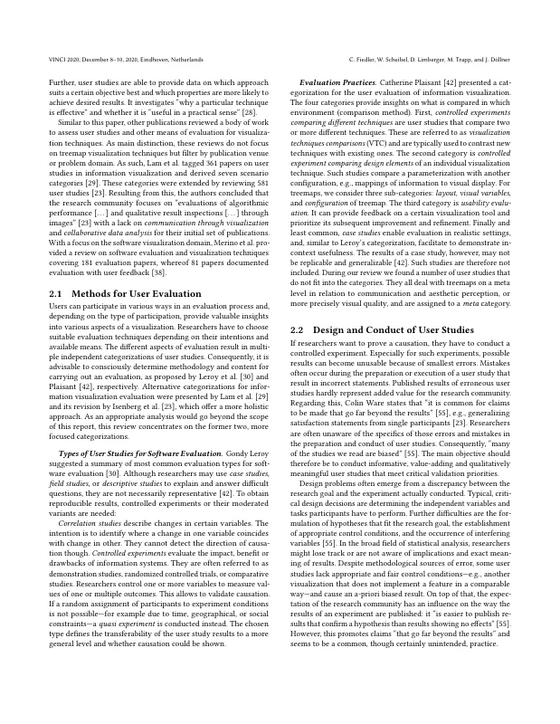
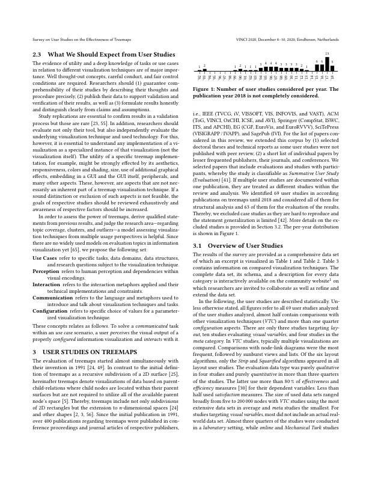
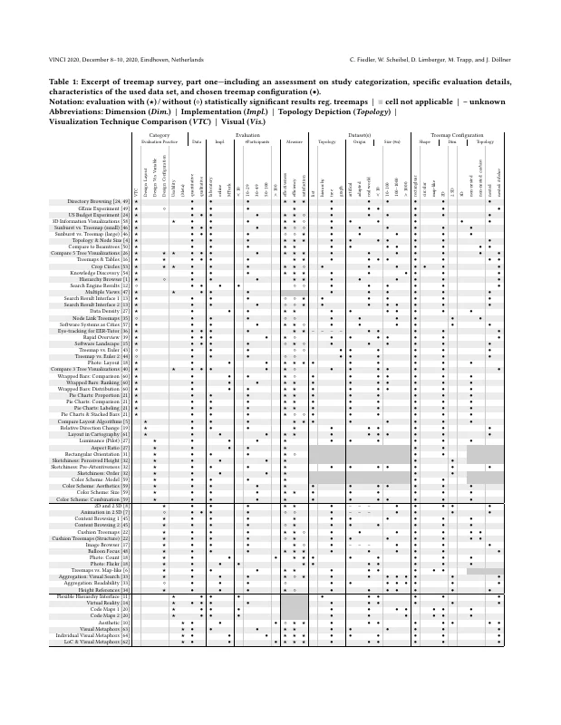
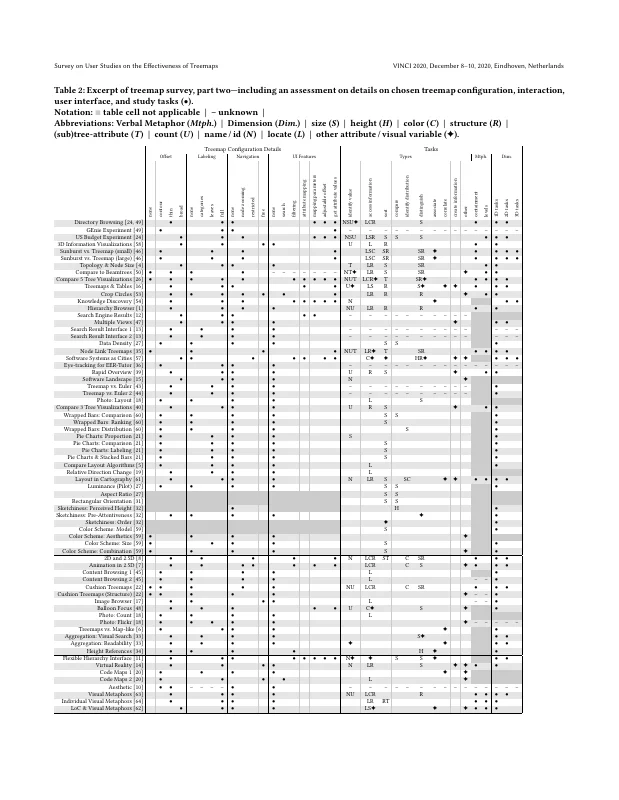
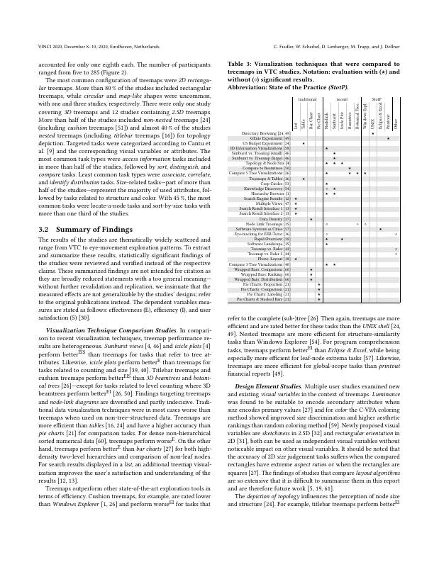
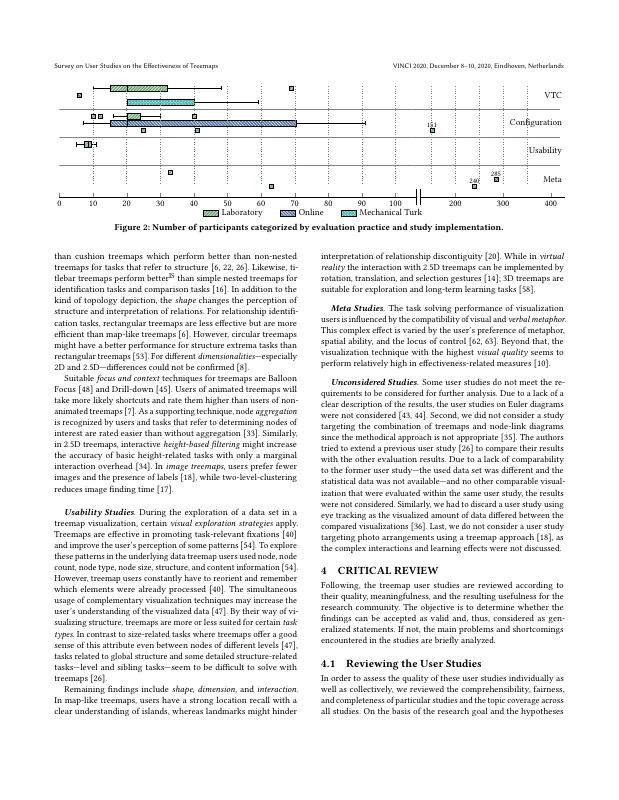
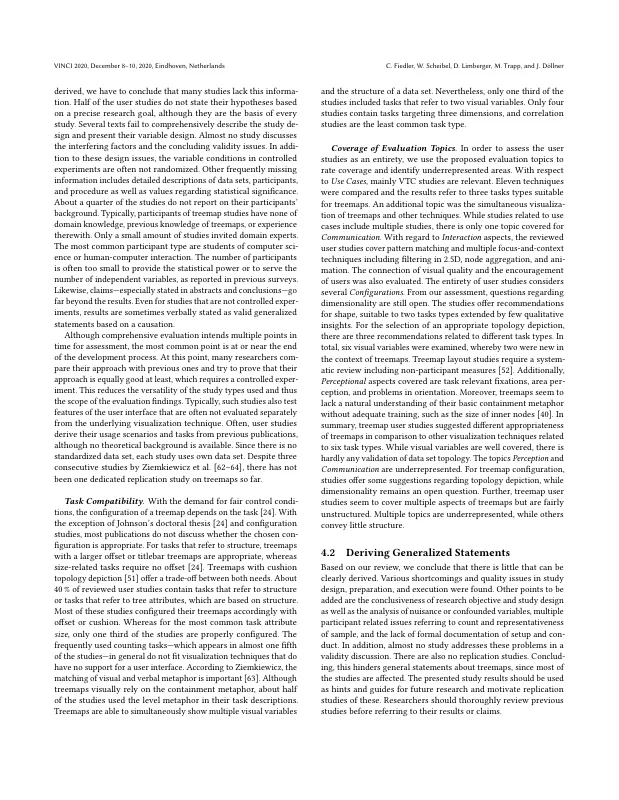
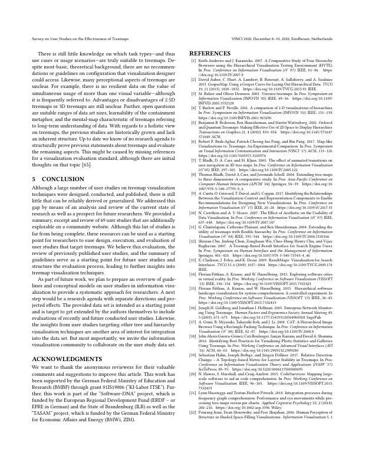
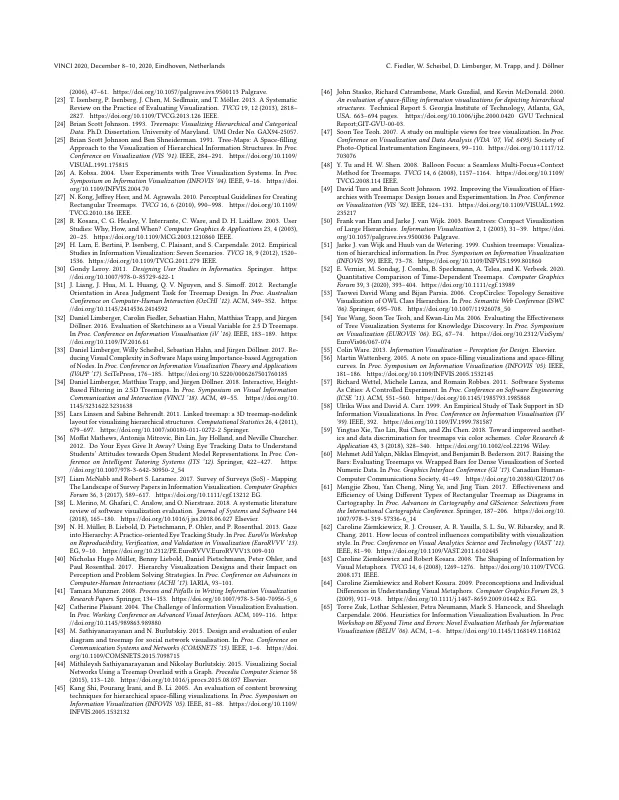

# Survey on User Studies on the Effectiveness of Treemaps

[Carolin Fiedler](https://orcid.org/0000-0002-6781-9534), [Willy Scheibel](https://orcid.org/0000-0002-7885-9857), [Daniel Limberger](https://orcid.org/0000-0002-9111-4809), [Matthias Trapp](https://orcid.org/0000-0003-3861-5759), and [Jürgen Döllner](https://orcid.org/0000-0002-8981-8583)

*Proceedings of the 13th International Symposium on Visual Information Communication and Interaction (VINCI '20)*, December 8–10, 2020, Eindhoven, Netherlands. ACM, pp. 2:1–10.

DOI: [10.1145/3430036.3430054](https://doi.org/10.1145/3430036.3430054) · Author's version: [Zenodo](https://doi.org/10.5281/zenodo.24061876) · [ResearchGate](https://www.researchgate.net/publication/346565359) · Data set: [varg-dev/treemap-studies](https://github.com/varg-dev/treemap-studies)

> Treemaps are a commonly used tool for the visual display and communication of tree-structured, multi-variate data.
> In order to confidently know when and how treemaps can best be applied, the research community uses usability studies and controlled experiments to "understand the potential and limitations of our tools" (Plaisant, 2004).
> To support the communities' understanding and usage of treemaps, this survey provides a comprehensive review and detailed overview of 69 user studies related to treemaps.
> However, due to pitfalls and shortcomings in design, conduct, and reporting of the user studies, there is little that can be reliably derived or accepted as a generalized statement.
> Fundamental open questions include configuration, compatible tasks, use cases, and perceptional characteristics of treemaps.
> The reliability of findings and statements is discussed and common pitfalls of treemap user studies are identified.

<p><a href="fiedler2020-effectiveness-as-submitted.pdf"></a> <a href="fiedler2020-effectiveness-as-submitted.pdf"></a> <a href="fiedler2020-effectiveness-as-submitted.pdf"></a> <a href="fiedler2020-effectiveness-as-submitted.pdf"></a> <a href="fiedler2020-effectiveness-as-submitted.pdf"></a> <a href="fiedler2020-effectiveness-as-submitted.pdf"></a> <a href="fiedler2020-effectiveness-as-submitted.pdf"></a> <a href="fiedler2020-effectiveness-as-submitted.pdf"></a> <a href="fiedler2020-effectiveness-as-submitted.pdf"></a> <a href="fiedler2020-effectiveness-as-submitted.pdf"></a></p>

## Contents

- [`src/`](src/) – LaTeX sources of the camera-ready version (ACM `acmart`, sigconf), as submitted to ACM; figures are TikZ/pgfplots drawn from `src/data/`
- [`fiedler2020-effectiveness-as-submitted.pdf`](fiedler2020-effectiveness-as-submitted.pdf) – camera-ready PDF as submitted to ACM
- [`build.sh`](build.sh) – reproducible build with TeX Live 2019 (podman or docker)
- [`preview/`](preview/) – page previews for this README

## Build

```bash
./build.sh        # → build/vinci_2020_19.pdf
```

The paper was compiled on Overleaf in November 2020, which still ran TeX Live 2019; the build uses the matching TeX Live 2019 container.
The build reproduces `fiedler2020-effectiveness-as-submitted.pdf` exactly (identical text, no pixel differences); TeX Live 2020 already changes one line break.

## Versions

- [`v1.0-camera-ready`](https://github.com/dl-archive/article.2020-vinci-survey-effectiveness/tree/v1.0-camera-ready) – sources as submitted to ACM (2020-11-03)

## Citation

```bibtex
@InProceedings{fiedler2020-effectiveness,
  author    = {Fiedler, Carolin and Scheibel, Willy and Limberger, Daniel and Trapp, Matthias and D{\"o}llner, J{\"u}rgen},
  title     = {Survey on User Studies on the Effectiveness of Treemaps},
  booktitle = {Proceedings of the 13th International Symposium on Visual Information Communication and Interaction},
  year      = {2020},
  series    = {VINCI~'20},
  publisher = {ACM},
  pages     = {2:1--10},
  doi       = {10.1145/3430036.3430054},
  isbn      = {978-1-450387-50-7},
}
```
